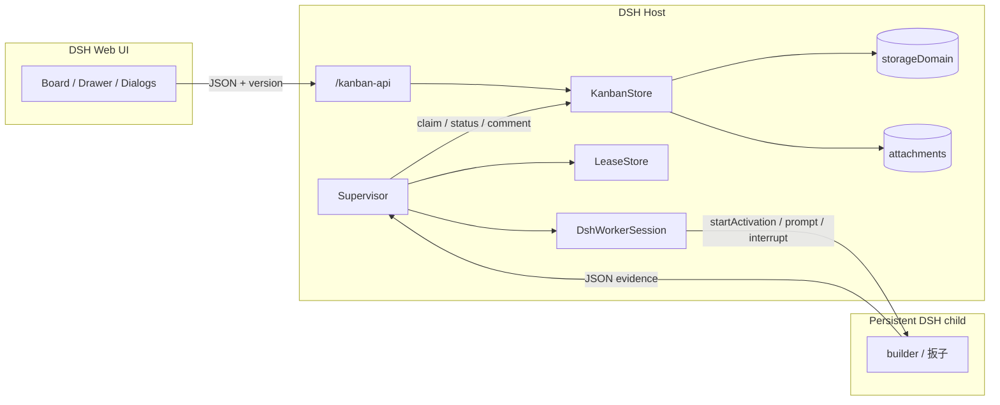

<p align="center">
  
</p>

<h1 align="center">DSH Kanban</h1>

<p align="center">
  <strong>A native board for DeepSeek Harness — and a supervisor that keeps persistent DSH workers on it.</strong><br/>
  Human decisions. Agent work. Verifiable evidence.
</p>

<p align="center">
  <a href="README.md">English</a> ·
  <a href="README.zh-CN.md">简体中文</a>
</p>

<p align="center">
  <a href="https://github.com/SilasSolivagus/dsh-kanban/actions/workflows/ci.yml"></a>
  
  
  
  <a href="LICENSE"></a>
</p>

<p align="center">
  
</p>

<p align="center">
  <sub>All projects view. Questions and blockers automatically collect in <b>Needs you</b>.</sub>
</p>

## The board is the shared state

DSH Kanban is a native Cordis plugin for [DeepSeek Harness](https://github.com/deepseek-ai/deepseek-harness). It is two things:

1. **A real board** — projects, cards, comments, attachments, approvals, activity.
2. **A supervisor** — wakes persistent DSH worker sessions, claims cards with a lease, enforces an evidence contract, and never writes Done without evidence.

> **Chat manages sessions. Kanban manages work.**<br/>
> Agent memory is a cache. The card is authoritative.

The board is not an agent chat with columns attached. It is the place where work becomes a commitment:

```text
intent → acceptance → owner → plan → progress → evidence → decision
```

## ✨ What you get

### Board

| | |
| --- | --- |
| **Four-column board** | Backlog, Running, Needs you, Done. Drag to move and reorder. |
| **Needs you** | Derived column for questions, blockers and reviews. Precedence: question → blocker → review. |
| **Approvals in the card** | Pick an option, add a note, approve or reject. |
| **Native task drawer** | Status, priority, labels, description, blocker, links, comments, attachments, activity. |
| **Durable Host storage** | `storageDomain` records survive refresh and restart. |
| **Archive and read-only** | Archive projects/tasks; restore later. |
| **Search and filters** | Title, description, project, labels, priority, assignee. |
| **DSH-native UI** | Theme tokens, `zh` / `en`, focus management, reduced motion. |

### Persistent DSH workers (P1 alpha)

| | |
| --- | --- |
| **Persistent sessions** | One DSH child per worker, resumed across supervisor restarts. Not a fresh subagent per card. |
| **Actor identity** | Every write carries a real agent actor: `builder`, not `LOCAL_USER`. |
| **Claim + lease** | One worker per card; lease TTL = worker timeout + 60s; expired leases can be reclaimed. |
| **Evidence contract** | Worker returns `{outcome, summary, evidence, notes}`. Done requires at least one evidence string. |
| **Blocked = Needs you** | Timeout, worker error, missing file, ambiguity, or invalid evidence becomes `blockedReason`, visible in **Needs you**. |
| **Crash-safe** | SIGKILL and plugin reload preserve board, lease and session ids; the restarted supervisor does not duplicate the prompt. |

## 🧭 Architecture



- **Board** owns state. Every write is versioned; stale writes get `TASK_VERSION_CONFLICT` (409).
- **Supervisor** polls assigned cards, claims a lease, wakes the persistent worker, and applies the result.
- **Worker** does the work and returns evidence. It does not edit board state directly in P1.
- **LeaseStore** persists claims in `~/.dsh/kanban-supervisor-state.json`.
- **DshWorkerSession** persists parent/child ids in `~/.dsh/kanban-worker-sessions.json`.

## 🚀 Quick start

**Requirements:** DSH `0.2.1-rc.2` or newer, Node.js 22+, pnpm 10+.

```bash
git clone https://github.com/SilasSolivagus/dsh-kanban.git
cd dsh-kanban
pnpm install
pnpm check
```

1. Open **DSH → Settings → Plugins**.
2. Choose **Install local bundle** and select this folder.
3. Enable `@local/dsh-kanban`.
4. Refresh DSH and open **Kanban**.

The board works with no worker config. The supervisor only starts when a worker file exists.

## 🤖 Enable a persistent worker

### 1. Actor tokens

Create `~/.dsh/kanban-agents.json` (mode `0600`). Tokens are local only.

```json
{
  "agents": [
    {
      "id": "office",
      "name": "Office",
      "role": "office",
      "projects": ["*"],
      "scopes": ["board:read", "board:create", "board:assign", "board:update:any", "board:comment"],
      "token": "replace-with-a-random-token"
    },
    {
      "id": "builder",
      "name": "Builder",
      "role": "builder",
      "projects": ["your-project-id"],
      "scopes": ["board:read", "board:update:own", "board:comment"],
      "token": "replace-with-a-random-token"
    }
  ]
}
```

`docs/agents.example.json` shows the shape. Never commit real tokens.

### 2. Worker config

Create `~/.dsh/kanban-workers.json` (mode `0600`). The supervisor auto-starts when this file exists.

```json
{
  "workers": [
    {
      "id": "builder",
      "name": "Builder",
      "role": "builder",
      "cwd": "/absolute/path/to/builder-workspace",
      "agentPreset": "standard",
      "maxConcurrent": 1,
      "timeoutSeconds": 300
    }
  ]
}
```

- `cwd` must exist and be absolute.
- `agentPreset` is required in practice; `standard` is the safe default.
- One supervisor process only. One worker per role in P1.
- Remove the file (or disable the plugin) to stop the supervisor.

### 3. Role prompts

The worker reads `docs/agents/<role>.md` as its role contract. Keep the JSON output contract intact:

```json
{
  "outcome": "done | blocked",
  "summary": "≤ 500 chars",
  "evidence": ["real command output, file path, or link"],
  "notes": "optional"
}
```

## 🔁 First card

```text
Silas → Office → card assigned to builder
  → supervisor claims a lease
  → builder session receives the card
  → builder returns JSON + evidence
  → reviewer pass → Done; reviewer reject → Needs you
  → without a reviewer: supervisor writes comment + Done
```

P1 live trial: **12 Done with evidence, 4 Needs you, 16 cards**, including:

- content, file, command and review work
- ambiguous request → blocked
- missing file → blocked
- done without evidence → blocked
- expired lease → reclaimed live
- real SIGKILL → app restarted, no duplicate prompt

## 🔍 Review gate

When the worker config declares a `reviewer` role, a builder's Done candidate takes one more step:

- A builder `done` result becomes `reviewing` instead of Done.
- The reviewer is a separate persistent DSH worker with its own `cwd` and `docs/agents/reviewer.md`.
- Reviewer `pass` → Done, with the verdict and its evidence commented on the card.
- Reviewer `reject` → the card stays `reviewing` with `blockedReason`, so it appears in **Needs you**.
- A reviewing card is picked up on the next supervisor cycle, not the same one.
- `in_review` remains the human attention state; the reviewer never uses it.
- With no reviewer configured, the builder-only path is unchanged.
- A reviewer never reviews a card assigned to itself.
- **Human override:** the supervisor gate is enforced for builder and reviewer writes. A human may explicitly move a `reviewing` card to Done from the task drawer; that manual override is intentional and is not a reviewer pass.
- `reviewing` is not offered in the create dialog, but it is available when a human edits an existing card's status.

**Live acceptance: PASS on 2026-10-23.** The builder → reviewing → reviewer pass → Done path (DSH-31) and the reviewer reject → **Needs you** path (DSH-32) were both verified on a live board. See the [P1.2 review gate record](docs/spikes/p1.2-review-gate.md).

## 🛡️ Safety model

- Tokens never enter cards, comments, prompts or Git.
- Agent writes pass an actor; missing actor does not fall back silently in supervisor paths.
- Workers cannot approve red decisions, delete/archive tasks, or manage projects.
- Blocked cards stay `in_progress` with `blockedReason` and appear in **Needs you**.
- The supervisor never marks Done without evidence.
- Per-worker workspace and one hidden parent per worker.
- P1 is local-only. It is not a sandbox between hostile users.

## ⚠️ Current limits

- Single supervisor, single builder; no multi-process coordination.
- Mac/DSH must be running; no hosted board yet.
- Worker tools depend on the DSH preset; `standard` is assumed.
- Lease reclaim after a real crash is tested, but full 7-day soak is not.
- Reviewer gate live acceptance passed on 2026-10-23 ([record](docs/spikes/p1.2-review-gate.md)); 7-day soak and Office entry are still open.
- No A2A, MCP, Grok adapter or hosted board yet.
- `README.zh-CN.md` may lag English details.

## 🗺️ Roadmap

- [x] **M1** — actor identity, tokens, project ACL, real activity
- [x] **P1 alpha** — persistent DSH worker, supervisor, lease, evidence, blocked/reclaim
- [x] **P1.2 review gate** — builder → reviewing → reviewer pass/reject, live-verified 2026-10-23
- [ ] **P1.2 remaining** — 7-day soak, Office entry
- [ ] **P1.3** — cost-tiered office: expensive lead, cheap workers, reusing the review gate
- [ ] **P2** — second runtime adapter (HTTP / Grok) against the same worker contract
- [ ] **P3** — hosted board: Postgres, TLS, auth, multi-user
- [ ] **P4** — A2A adapter

See [the product plan](docs/superpowers/plans/2026-10-23-agent-board-product.md) and [P1 plan](docs/superpowers/plans/2026-10-23-p1-persistent-dsh-bots.md).

## 📚 Documentation

- [Usage guide (English)](docs/usage.en.md)
- [使用说明（中文）](docs/usage.md)
- [P1 trial](docs/spikes/p1.1-ten-card-trial.md)
- [Lease reclaim + crash probe](docs/spikes/p1.1-lease-and-crash.md)
- [Real SIGKILL probe](docs/spikes/p1.1-kill9.md)
- [P1.2 review gate runbook](docs/spikes/p1.2-review-gate.md)
- [Hosted board plan](docs/superpowers/plans/2026-10-23-hosted-kanban-a2a.md)

## 🛠️ Development

```bash
pnpm build      # build Host index.js + Client client.js
pnpm test       # node --test
pnpm check      # build + test
```

```text
src/
  host/
    supervisor/   # config, board port, lease, prompt, session, cycle
    entry.js      # plugin wiring
    http.js       # /kanban-api
    store.js      # board persistence
  client/         # board, cards, drawer, dialogs
  shared/         # statuses, columns, attention rules
docs/
  agents/         # role contracts
  spikes/         # live trial evidence
```

Tests use Node's built-in runner. No browser test dependency is required.

## 🤝 Contributing

Issues and PRs are welcome.

- Bug? Include DSH version, OS and reproduction.
- Feature? Keep the board contract and evidence rules intact.
- New runtime? Implement the worker adapter, not a second board.

## 📄 License

[MIT](LICENSE) © 2026 Silas Solivagus.

## 🙏 Acknowledgements

Built on DSH's native slot, locale, `storageDomain`, attachment, HTTP and session services.
