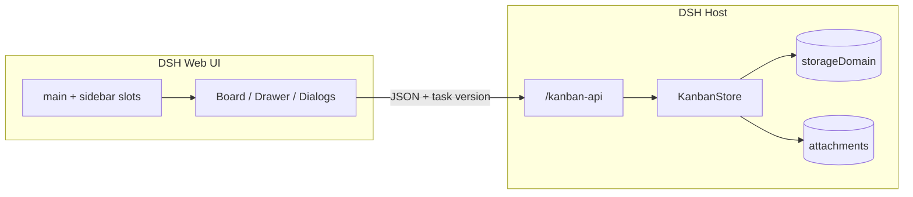

<p align="center">
  
</p>

<h1 align="center">DSH Kanban</h1>

<p align="center">
  <strong>The native task board for DeepSeek Harness.</strong><br/>
  Four columns. Durable persistence. No iframe.
</p>

<p align="center">
  <a href="README.md">English</a> ·
  <a href="README.zh-CN.md">简体中文</a>
</p>

<p align="center">
  
  
  
  <a href="LICENSE"></a>
</p>

<p align="center">
  
</p>

<p align="center">
  <sub>All projects view. Questions and blockers automatically collect in <b>Needs you</b>.</sub>
</p>

## Your agent needs a queue. You need a board.

DSH Kanban is a **native Cordis plugin** for [DeepSeek Harness](https://github.com/deepseek-ai/deepseek-harness). It registers a real page in the `main` slot and a real entry in `sidebar.panellist` — not a web app inside an iframe.

Projects, tasks, comments, attachments and activity live in the Host's `storageDomain`. The browser is never the source of truth.

The board is built for the loop between a human and an agent:

1. The agent creates work, records a blocker, or asks a question.
2. The card moves to **Needs you** automatically.
3. You answer in the card — approve, reject, unblock, comment.
4. The task moves to **Done**, with the full activity trail.

> One board. One data model. No second tab to keep in sync.

## ✨ What you get

| | |
| --- | --- |
| **Four-column board** | Backlog, Running, Needs you, Done. Drag to move, drag to reorder, collapse columns. |
| **Needs you** | A derived column for unanswered questions, blockers and reviews. Precedence: question → blocker → review. |
| **Approvals in the card** | Pick an option, add a note, approve or reject. Approval moves to Done; rejection returns to Backlog. |
| **Native task drawer** | Status, priority, labels, description, blocker, links, request input, comments, attachments, activity. |
| **Durable Host storage** | `storageDomain` records survive refresh and restart. Attachments use DSH attachment storage. |
| **Archive and read-only** | Archive projects and tasks; restore them later. Archived projects open read-only with a restore banner. |
| **Search and filters** | Search title, description, project and labels. Filter by project, priority, label or assignee. |
| **DSH-native UI** | Theme tokens, `zh` / `en` locale, focus management, reduced-motion support. |

## 🚀 Quick start

**Requirements:** DSH `0.2.1-rc.2` or newer, Node.js 22+, pnpm 10+.

```bash
git clone https://github.com/SilasSolivagus/dsh-kanban.git
cd dsh-kanban
pnpm install
pnpm check
```

Then:

1. Open **DSH → Settings → Plugins**.
2. Choose **Install local bundle** and select this folder (the one with `package.json`).
3. Enable `@local/dsh-kanban`.
4. Refresh DSH and click **Kanban** in the sidebar.

The profile keeps a link to this folder, so updates are:

```bash
git pull
pnpm install
pnpm check
```

Then disable/enable `@local/dsh-kanban` once and refresh.

> `pnpm check` builds `index.js` / `client.js` and runs the full suite. Both generated bundles are committed, so a fresh install does not need a build step.

## 🧭 How it works



- **Client:** registers slots and locale, renders the board, drawer and dialogs, calls `/kanban-api`.
- **Host:** owns the domain, routes, validation and optimistic concurrency. Every task write carries a `version`; stale writes get `TASK_VERSION_CONFLICT` (HTTP 409).
- **Storage:** project/task/comment/activity records in `storageDomain`; attachment bytes through `ctx.attachments`; only column-collapse preferences use localStorage.

### Why native instead of an iframe

| | iframe board | DSH Kanban |
| --- | --- | --- |
| Theme and locale | drifts from the app | native tokens + locale |
| Persistence | browser localStorage | Host `storageDomain` |
| Attachments | awkward bridge | DSH attachment service |
| Navigation | nested page | `main` + `sidebar.panellist` |
| Approvals | separate workflow | real Needs you queue |

## 📸 Inside a task

<p align="center">
  
</p>

The drawer is the full record, not a read-only preview: edit properties, set or clear a blocker, request input, answer questions, add links, comments and attachments, and read the activity stream.

## 🗺️ Roadmap

- [x] **v2.0.0** — native DSH page, four-column board, approvals, comments, attachments, archive and read-only projects
- [ ] Saved filter views
- [ ] Keyboard-first command palette and quick add
- [ ] Import / export (JSON and Markdown)
- [ ] Real-time multi-user collaboration
- [ ] Mobile-friendly layout

Planned, not promised. Open an issue if you want to shape the order.

## 🛠️ Development

```bash
pnpm build      # build Host index.js + Client client.js
pnpm test       # node --test
pnpm check      # build + test
```

```text
src/
  host/          # entry, domain, schema, store, HTTP routes
  client/        # slots, app shell, board, cards, drawer, dialogs
  shared/        # statuses, columns, attention rules
scripts/build.mjs
locale/          # plugin metadata (zh / en)
docs/            # usage guide and screenshots
```

- `index.js` is the Host bundle; runtime DSH packages are external.
- `client.js` is the Client bundle wrapped for `window.__ModuleLoader__`.
- Tests use Node's built-in test runner; no browser test dependency is required.

See [CONTRIBUTING.md](CONTRIBUTING.md) for the PR checklist.

## 📚 Documentation

- [Usage guide (English)](docs/usage.en.md)
- [使用说明（中文）](docs/usage.md)
- [Design notes](docs/superpowers/specs/2026-10-21-dsh-kanban-design.md)
- [Implementation plan](docs/superpowers/plans/2026-10-21-dsh-kanban.md)

## 🤝 Contributing

Issues and pull requests are welcome.

- Found a bug? Open an issue with DSH version, OS and reproduction steps.
- Built something useful? Send a focused PR with a test.
- Like the direction? Star the repo — it helps other DSH users find it.

## 📄 License

[MIT](LICENSE) © 2026 Silas Solivagus.

## 🙏 Acknowledgements

Built on DSH's native slot, locale, `storageDomain`, attachment and HTTP services. Thanks to the DeepSeek Harness team for making a plugin surface that is worth building on.
