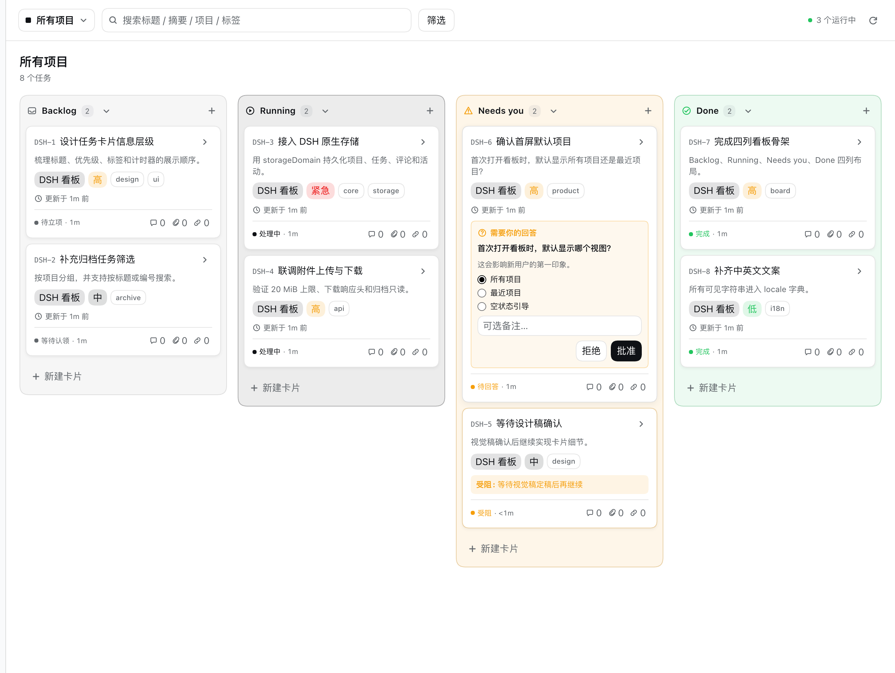
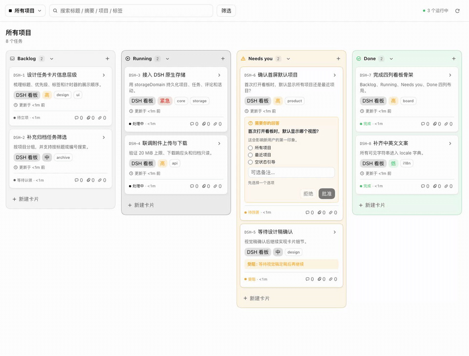
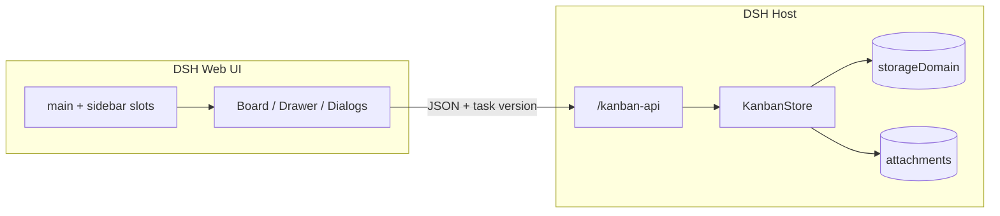
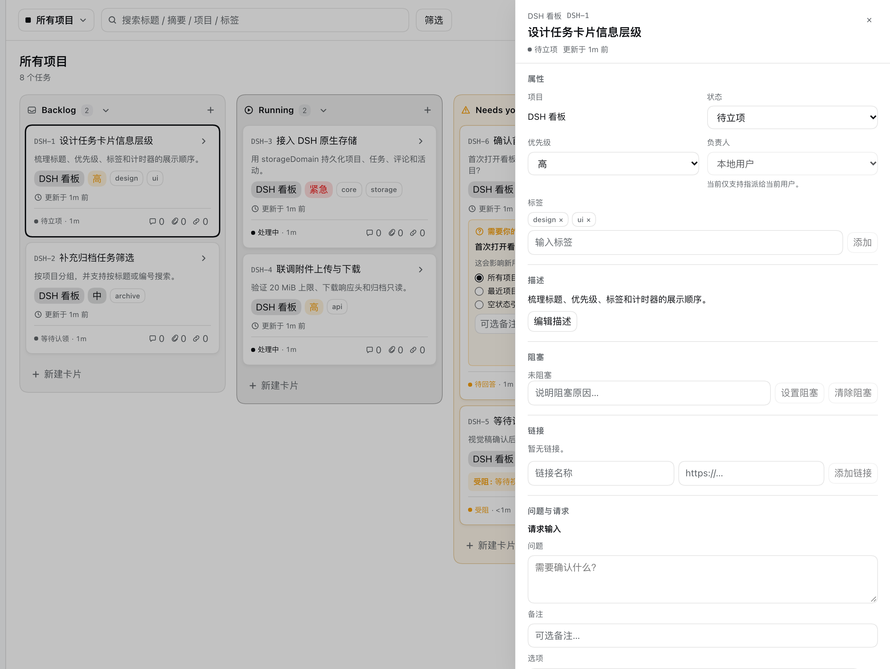

<p align="center">
  
</p>

<h1 align="center">DSH 看板</h1>

<p align="center">
  <strong>DeepSeek Harness 的原生任务看板。</strong><br/>
  四列看板 · Host 持久化 · 不是 iframe
</p>

<p align="center">
  <a href="README.md">English</a> ·
  <a href="README.zh-CN.md">简体中文</a>
</p>

<p align="center">
  <a href="https://github.com/SilasSolivagus/dsh-kanban/actions/workflows/ci.yml"></a>
  
  
  
  <a href="LICENSE"></a>
</p>

<p align="center">
  
</p>

<p align="center">
  <sub>All projects 视图。问题与阻塞会自动汇聚到 <b>Needs you</b>。</sub>
</p>

## 给 agent 一个队列，给你一个看板

DSH 看板是 [DeepSeek Harness](https://github.com/deepseek-ai/deepseek-harness) 的**原生 Cordis 插件**。它注册的是真实的 `main` 页面和 `sidebar.panellist` 入口，不是一个塞进 iframe 的网页。

项目、任务、评论、附件和活动都存在 Host 的 `storageDomain` 里。浏览器不是数据源。

> **Chat 管会话，看板管任务。**  
> DSH Kanban 给 agent 一个不随会话结束而消失的任务层。

这个看板围绕「人 + agent」的循环设计：

1. agent 创建任务、记录阻塞，或向你提问。
2. 卡片自动进入 **Needs you**。
3. 你在卡片里回答、批准、拒绝、清除阻塞、评论。
4. 任务进入 **Done**，活动记录完整保留。

> 一个看板，一套数据模型，不用再开第二个标签页同步。

## ✨ 能力

| | |
| --- | --- |
| **四列看板** | Backlog、Running、Needs you、Done；拖拽换列/排序，列可折叠 |
| **Needs you** | 自动汇聚未回答问题、阻塞、待审核；优先级：问题 → 阻塞 → 审核 |
| **卡片内审批** | 选择选项、备注、Approve / Reject；批准进 Done，拒绝回 Backlog |
| **任务抽屉** | 状态、优先级、标签、描述、阻塞、链接、请求输入、评论、附件、活动 |
| **Host 持久化** | `storageDomain` 记录刷新/重启不丢；附件走 DSH attachment |
| **归档与只读** | 项目/任务归档、恢复；归档项目只读并显示恢复横幅 |
| **搜索与筛选** | 标题/描述/项目/标签搜索；项目、优先级、标签、负责人筛选 |
| **DSH 原生体验** | 主题 token、中英文 locale、焦点管理、减少动画 |

## 🎬 动起来

<p align="center">
  
</p>

<p align="center">
  <sub>打开卡片 → 在抽屉里回答问题 → Approve → 卡片自动进入 Done。</sub>
</p>

## 🚀 快速开始

**要求：** DSH `0.2.1-rc.2` 或更新版本、Node.js 22+、pnpm 10+。

```bash
git clone https://github.com/SilasSolivagus/dsh-kanban.git
cd dsh-kanban
pnpm install
pnpm check
```

然后：

1. 打开 **DSH → 设置 → 插件**。
2. 选择 **安装本地 bundle**，选中这个目录（包含 `package.json` 的那一层）。
3. 启用 `@local/dsh-kanban`。
4. 刷新 DSH，点击侧边栏的 **看板 / Kanban**。

profile 里会保留一个指向该目录的 `link:`，升级时：

```bash
git pull
pnpm install
pnpm check
```

然后在插件页禁用再启用一次 `@local/dsh-kanban`，刷新页面。

> `pnpm check` 会构建 `index.js` / `client.js` 并运行完整测试。两个构建产物已提交，普通安装不需要自己构建。

## 🧭 架构



- **Client：** 注册 slot/locale，渲染看板、抽屉和对话框，调用 `/kanban-api`。
- **Host：** 负责领域数据、路由、校验和乐观并发。每次任务写入都带 `version`，旧版本写入返回 `TASK_VERSION_CONFLICT`（HTTP 409）。
- **存储：** 项目/任务/评论/活动在 `storageDomain`；附件字节走 `ctx.attachments`；只有列折叠偏好用 localStorage。

### 为什么不用 iframe

| | iframe 看板 | DSH 看板 |
| --- | --- | --- |
| 主题与语言 | 容易和应用不一致 | 原生 token + locale |
| 持久化 | 浏览器 localStorage | Host `storageDomain` |
| 附件 | 桥接麻烦 | DSH attachment 服务 |
| 导航 | 嵌套页面 | `main` + `sidebar.panellist` |
| 审批 | 独立流程 | 真实 Needs you 队列 |

## 📸 任务抽屉

<p align="center">
  
</p>

抽屉是完整记录，不是只读预览：编辑属性、设置/清除阻塞、请求输入、回答问题、添加链接/评论/附件，并查看活动流。

## 🗺️ Roadmap

- [x] **v2.0.0** — DSH 原生页面、四列看板、审批、评论、附件、归档与只读项目
- [ ] 保存筛选视图
- [ ] 键盘优先的命令面板与快速新建
- [ ] 导入/导出（JSON 与 Markdown）
- [ ] 实时多人协作
- [ ] 移动端布局

以上是计划，不是承诺；想要哪个先做，可以开 issue。

## 🛠️ 开发

```bash
pnpm build      # 构建 Host index.js + Client client.js
pnpm test       # node --test
pnpm check      # build + test
```

```text
src/
  host/          # entry、domain、schema、store、HTTP 路由
  client/        # slots、App、Board、TaskCard、TaskDrawer、dialogs
  shared/        # 状态、列、attention 规则
scripts/build.mjs
locale/          # 插件元数据（zh / en）
docs/            # 使用说明与截图
```

- `index.js` 是 Host bundle；DSH 运行时包保持 external。
- `client.js` 是 Client bundle，由 `window.__ModuleLoader__` 包装。
- 测试使用 Node 内置 test runner，不依赖浏览器测试框架。

PR 前请看 [CONTRIBUTING.md](CONTRIBUTING.md)。

## 📚 文档

- [使用说明（中文）](docs/usage.md)
- [Usage guide (English)](docs/usage.en.md)
- [设计说明](docs/superpowers/specs/2026-10-21-dsh-kanban-design.md)
- [实现计划](docs/superpowers/plans/2026-10-21-dsh-kanban.md)

## 🤝 贡献

Join the conversation in [GitHub Discussions](https://github.com/SilasSolivagus/dsh-kanban/discussions).

欢迎 issue 和 PR。

- 发现 bug：附上 DSH 版本、系统、复现步骤。
- 做了改进：提交聚焦的 PR，并补测试。
- 觉得方向对：点个 star，让更多 DSH 用户看到。

## 📄 License

[MIT](LICENSE) © 2026 Silas Solivagus。

## 🙏 致谢

建立在 DSH 的原生 slot、locale、`storageDomain`、attachment 和 HTTP 服务之上。感谢 DeepSeek Harness 团队提供值得构建的插件表面。
